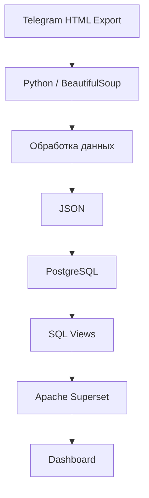

# Telegram Chat Analytics

### Анализ переписки Telegram с использованием Python, PostgreSQL и Apache Superset

## О проекте

В рамках проекта разработан ETL-процесс для обработки и анализа данных из экспорта переписки Telegram.

Исходные данные представлены HTML-файлами, которые содержат сообщения, информацию об авторах, временные метки и сведения о вложениях. С помощью Python данные извлекаются из HTML, приводятся к единой структуре и сохраняются в JSON. Затем они загружаются в PostgreSQL, где с помощью SQL формируется аналитическое представление для исследования текстового содержимого переписки.

Завершающий этап — визуализация результатов в Apache Superset.

Основная идея проекта — пройти весь путь от исходных данных до готовой аналитики, не ограничиваясь только построением графиков.


## Архитектура



## Используемые технологии

| Инструмент      | Назначение                                      |
| --------------- | ----------------------------------------------- |
| Python 3.13     | Обработка и преобразование данных               |
| BeautifulSoup   | Извлечение информации из HTML                   |
| JSON            | Промежуточное хранение данных                   |
| PostgreSQL      | Хранение и обработка данных                     |
| Psycopg 3       | Подключение Python к PostgreSQL                 |
| SQL             | Создание представлений и аналитических запросов |
| Apache Superset | Построение графиков и дашборда                  |
| Docker Compose  | Запуск Superset                                 |
| Git             | Контроль версий                                 |

## Реализация

### 1. Обработка исходных данных

Для начала были изучены HTML-файлы экспорта Telegram и их структура. Сообщения представлены отдельными HTML-блоками, из которых необходимо извлечь нужные атрибуты.

Для парсинга использовалась библиотека BeautifulSoup.

В результате обработки формируются записи со следующими полями:

- `message_id` — идентификатор сообщения;
- `author` — автор;
- `date` — дата и время отправки;
- `text` — текст сообщения;
- `forwarded_text` — текст пересланного сообщения;
- `media_type` — тип вложения;
- `media_name` — название файла.

При обработке учитывались сообщения без обычного текста, пересланные сообщения и вложения. Результат сохраняется в JSON, который используется как промежуточный формат перед загрузкой в базу данных.

### 2. Загрузка в PostgreSQL

Для хранения данных была создана таблица `messages`.

Загрузка реализована на Python с использованием Psycopg 3. При записи данных временные метки преобразуются в формат `datetime` с сохранением часового пояса.

Для предотвращения появления дубликатов используется:

```sql
ON CONFLICT (message_id) DO NOTHING
```

Таким образом, повторный запуск загрузки не приводит к повторному добавлению уже существующих сообщений.

Параметры подключения к PostgreSQL вынесены в `.env` и загружаются с помощью `python-dotenv`. Это позволяет не хранить настройки подключения непосредственно в исходном коде.

### 3. SQL-аналитика

После загрузки данных основная работа с ними выполняется в PostgreSQL.

Для анализа текстов было создано представление `word_statistics`. Оно позволяет перейти от анализа сообщений целиком к анализу отдельных слов.

Для извлечения слов используется функция `regexp_matches` и конструкция `CROSS JOIN LATERAL`.

В результате одно сообщение может соответствовать нескольким строкам представления: каждая строка содержит отдельное слово, идентификатор исходного сообщения, автора и дату.

Это позволяет рассчитывать частоту употребления слов, сравнивать результаты между участниками и исследовать изменения во времени.

Для поиска интересующих выражений используется `ILIKE` с шаблоном. Это поиск по текстовому вхождению, а не семантический поиск.

На текущем этапе анализируется поле `message_text`; пересланный текст хранится отдельно.

### 4. Визуализация в Apache Superset

Для визуализации результатов используется Apache Superset, запущенный через Docker Compose.

В качестве источника данных подключена локальная база PostgreSQL. На основе таблицы `messages` и представления `word_statistics` созданы наборы данных, из которых построены графики.

Дашборд содержит:

- общее количество сообщений;
- количество употреблений выбранного слова;
- распределение употреблений между участниками;
- частоту отдельных словоформ;
- динамику употребления по дням;
- изменение активности участников во времени.

### Дашборд проекта


## Результаты обработки

Для проверки работы парсера использовался экспорт, состоящий из семи HTML-файлов.

| Показатель                      | Результат |
| ------------------------------- | --------: |
| Обработано HTML-файлов          |         7 |
| Извлечено сообщений             |     6 389 |
| Сообщений без обычного текста   |       344 |
| Сообщений с пересланным текстом |        43 |
| Записей без автора или даты     |         0 |
| Дублирующихся идентификаторов   |         0 |

Дополнительно были извлечены сведения о медиафайлах: фотографиях, стикерах, документах, видео, голосовых сообщениях и анимациях.

## Структура проекта

```text
telegram-chat-analytics/
│
├── src/
│   ├── check_files.py
│   ├── load_data.py
│   └── tests_db.py
│
├── sql/
│   ├── create_tables.sql
│   ├── create_views.sql
│   └── analytics.sql
│
├── requirements.txt
├── .env.example
├── .gitignore
└── README.md
```

## Запуск проекта

Для работы потребуются Python, PostgreSQL, Docker и Docker Compose.

**1. Клонирование репозитория**

```bash
git clone https://github.com/YOUR_USERNAME/telegram-chat-analytics.git
cd telegram-chat-analytics
```

**2. Создание виртуального окружения**

```bash
python -m venv .venv
```

Для Windows:

```powershell
.venv\Scripts\activate
```

**3. Установка библиотек**

```bash
pip install -r requirements.txt
```

**4. Настройка подключения**

Создать файл `.env` на основе `.env.example` и указать параметры подключения к PostgreSQL.

**5. Создание таблицы**

Создать базу данных `chat_analysis` и выполнить скрипт:

```text
sql/create_tables.sql
```

**6. Подготовка данных**

Экспортировать переписку Telegram в HTML и разместить файлы в директории, ожидаемой парсером.

Запустить обработку:

```bash
python src/check_files.py
```

**7. Загрузка данных**

```bash
python src/load_data.py
```

**8. Создание представления**

Выполнить SQL-скрипт:

```text
sql/create_views.sql
```

Дополнительные запросы для анализа находятся в `sql/analytics.sql`.

**9. Построение дашборда**

Подключить PostgreSQL к Apache Superset, создать наборы данных и построить визуализации на основе таблицы и представления.

## Что можно улучшить

В дальнейшем проект можно развить в нескольких направлениях:

- добавить автоматический запуск и регулярное обновление ETL-процесса;
- расширить анализ за счёт пересланных сообщений;
- реализовать лемматизацию для объединения разных словоформ;
- добавить полнотекстовый поиск PostgreSQL;
- исследовать применение векторных представлений для семантического анализа;
- добавить автоматические проверки качества данных.

---

**Итог:** в проекте реализован полный цикл обработки данных — от парсинга исходного HTML до хранения в PostgreSQL и построения аналитического дашборда в Apache Superset.
